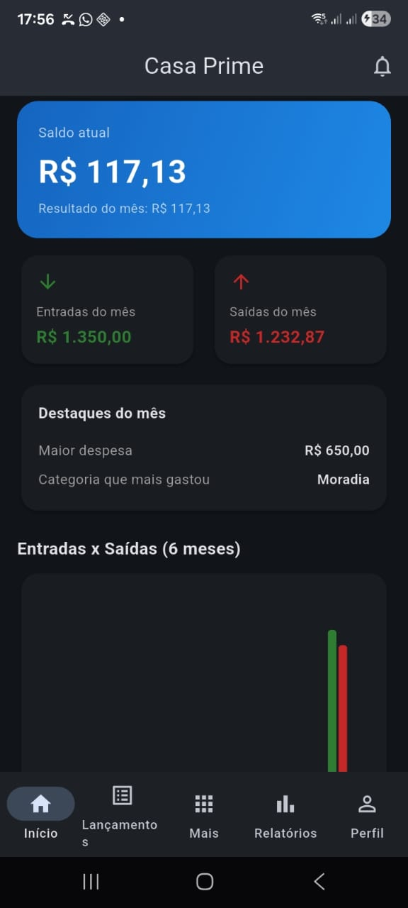
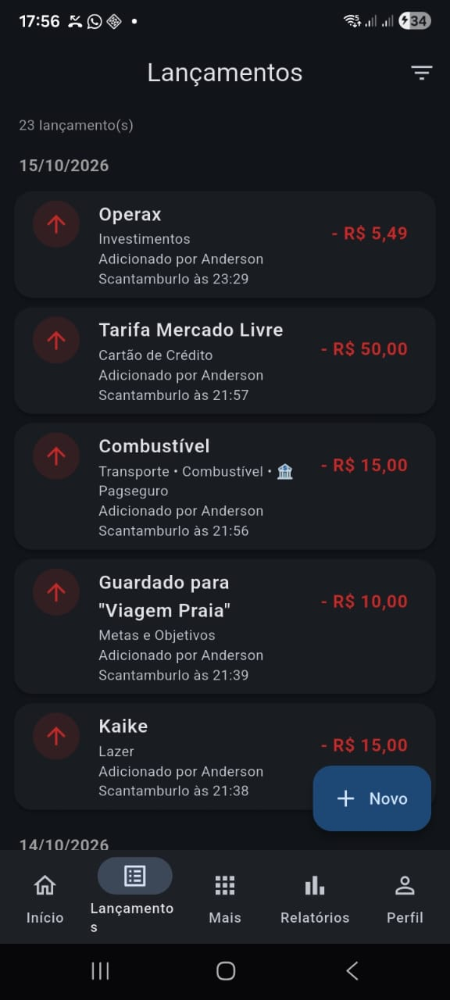
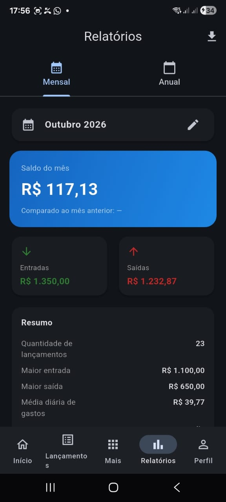
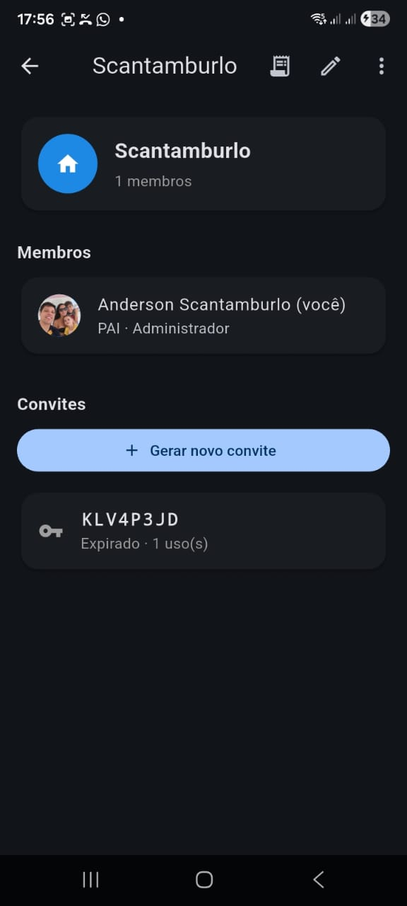
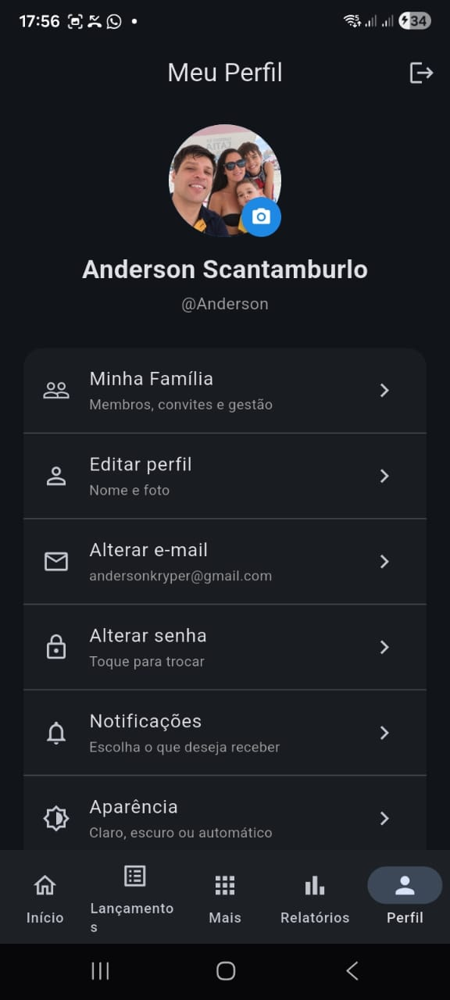

**Casa Prime — Gerenciamento Financeiro Familiar**
*Criado por Anderson Scantamburlo*

Aplicativo mobile completo desenvolvido em Flutter para famílias organizarem, compartilharem e acompanharem suas finanças de forma simples e transparente.

---

### 📱 Sobre o Aplicativo
Diferente de apps individuais, o **Casa Prime** permite que múltiplos membros da mesma família participem de uma conta compartilhada. Cada membro tem seu próprio acesso, mas todos visualizam e contribuem para o mesmo ecossistema financeiro.

**Principais Funcionalidades:**
- **Multiusuário:** Crie uma família e convide membros via código.
- **Permissões:** Admins gerenciam a família; membros lançam e visualizam.
- **Lançamentos:** Entradas e saídas com categoria, conta e forma de pagamento.
- **Metas Financeiras:** Objetivos com lançamento automático ao guardar dinheiro.
- **Recorrências:** Salário, aluguel e assinaturas lançados automaticamente.
- **Parcelamento:** Divida compras de cartão em até 24x.
- **Relatórios:** Gráficos interativos e exportação em PDF/CSV.
- **Tema:** Modo claro e escuro com sincronização.
- **Notificações:** Alertas no app quando membros fazem alterações.

---

### 📸 Telas do Aplicativo

| Dashboard | Lançamentos | Metas |
| :---: | :---: | :---: |
|  |  |  |

| Relatórios | Família | Perfil |
| :---: | :---: | :---: |
|  |  |  |

---

### 🛠️ Tecnologias Utilizadas
- **Framework:** Flutter / Dart
- **Banco de Dados:** Firebase Cloud Firestore (Tempo real)
- **Autenticação:** Firebase Auth
- **Armazenamento:** Cloudinary (Fotos de perfil)
- **Gráficos:** fl_chart
- **Exportação:** pdf, printing, share_plus
- **Arquitetura:** Clean Architecture

---

### 📥 Como Instalar (APK)
1. Acesse a aba **[Releases](../../releases)** deste repositório.
2. Baixe o arquivo `app-release.apk` da versão mais recente.
3. No celular Android, permita a instalação de fontes desconhecidas.
4. Instale e abra o **Casa Prime**.
*Requisito: Android 6.0 (Marshmallow) ou superior.*